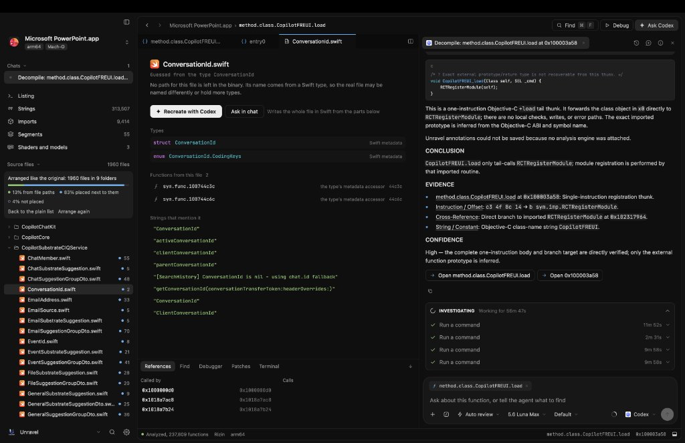

<p align="center">
  <picture>
    <source media="(prefers-color-scheme: dark)" srcset="docs/images/icon-dark.png">
    
  </picture>
</p>

<h1 align="center">Unravel</h1>

<p align="center">
  <strong>Agent-first reverse-engineering application for macOS, Windows, and Linux.</strong>
</p>

<p align="center">
  <a href="https://github.com/aryanchauhan3800/Unravel/releases"></a>
  <a href="https://github.com/aryanchauhan3800/Unravel/stargazers"></a>
</p>

<p align="center">
  
</p>

Unravel is a reverse-engineering app built around agents. Drop in an app, a binary, an Android APK, a GPU kernel, a shader or a model and ask what it does. Any agent that speaks the [Agent Client Protocol](https://agentclientprotocol.com) can read the code, follow references, rename functions, leave notes and suggest patches, while you watch and approve in the same window.

Native code is read by [Ghidra](https://ghidra-sre.org) through [REA](https://github.com/morluto/rea), or by [Rizin](https://rizin.re) when you want files to open in seconds. Android apps are read by [jadx](https://github.com/skylot/jadx). The UI is React rendered natively on GPUI by [GPUIX](https://www.npmjs.com/package/@gpuix/react).

## Features

- **Bring your own agent.** Aster, Claude, Codex, Gemini, Cursor, Copilot, OpenCode and any other ACP agent. Run several on the same project, each in its own chat.
- **Agents drive the window.** Unravel serves its own MCP tools so an agent can open a function, switch views, rename, add notes, change types and propose patches.
- **Ask about any code.** Select lines in pseudocode, assembly or a source file and ask, explain or copy them. The answer opens under the lines, and a suggested rename arrives as a card you accept or decline.
- **You stay in control.** Every change by you or an agent is logged with its author and can be undone. Byte patches from agents arrive as suggestions you accept or decline.
- **Mach-O, ELF and PE.** Functions, pseudocode, assembly, control-flow graph, cross-references, strings, segments and hex. Change a line's type (code, procedure, data, string) and number format with Hopper's keys.
- **Android apps.** APKs open with Java from jadx, smali from apktool when it's installed, string resources, and the manifest, `res`, assets and native libraries in a Resources list. Split bundles (`.xapk`, `.apks`) open with every split in place.
- **Source files.** Unravel finds the source files a binary was built from, reads Swift types straight from the binary, and has your agent recreate a whole file, with each function linked back to its address.
- **Rewrite in any language.** Show a function's pseudocode rewritten by your agent in C, C++, Rust, Go, Swift, Python, TypeScript, Java, C# or Zig.
- **GPU kernels.** CUDA and HIP fat binaries open as highlighted PTX, with notes beside each block and rewrites in CUDA C++, HIP C++ or Metal.
- **Shaders, models and GPU profiles.** Metal shaders and ML model files (GGUF, safetensors, PyTorch, ONNX) open in the workbench, linked to the code that loads them. Profile with Instruments.
- **Projects.** A project is one app or binary and holds its chats, agents, renames, bookmarks, notes and patches. Press ⌘S to save it as a single `.unravel` file you can share. Nothing is written there until you do.
- **Patching.** Edit bytes at an address and write a patched copy. The original is never touched.
- **Diffing.** Compare two builds by function and read the changes like a code review.
- **Debugging.** Run a program under LLDB, break on the function you are looking at, step and read locals.
- **Playbooks.** Built-in skills such as first look, name functions, trace a feature and network map work with any agent.
- **Export.** Pseudocode, assembly, control-flow graphs as PDF and Objective-C class inventories.

## Working with Code IDEs & Agents

Unravel pairs directly with AI coding assistants and agentic IDEs such as Antigravity, Cursor, Codex, and Claude Code.

<p align="center">
  
</p>

When you use Unravel to reverse-engineer an application, your IDE writes the clean-room reimplementation in a dedicated project directory, keeping Unravel's own repository completely untouched.

### Communication Bridges

- **Unravel MCP Server (`eleven`)**: Unravel runs an internal Model Context Protocol server over a local socket. Your IDE connects directly to query `current_view` (active binary, function, and address), navigate with `open_function`, and synchronize renames or notes.
- **Shared REA Toolchain**: Both Unravel and your IDE tap into the same REA 6.x engine (headless Ghidra and Rizin) to inspect decompiled pseudocode, assembly instructions, and cross-references.
- **Slices Cache**: Unravel unpacks thin Mach-O slices, decompiled Objective-C interfaces, and Swift symbol maps into `~/Library/Caches/unravel/slices/<sha256>/`. Your IDE reads these cached files instantly with zero latency.

### Clean-Room Workflow

```
1. Open Target in Unravel        -> Drop binary into /Applications/Unravel.app
2. IDE Connects via MCP/Cache   -> Agent inspects active view, symbols, and geometry
3. Clean Project Generated      -> Source code written in ~/Developer/<TargetApp>/
4. Native Build & Installation  -> Compiled and signed to /Applications/<TargetApp>.app
```

## Support Unravel

Unravel is free and open source. If it saves you time, starring the repository or [sponsoring on GitHub](https://github.com/sponsors/aryanchauhan3800) helps support ongoing development.

## Install

**macOS** 14 or later on Apple Silicon:

```sh
curl -fsSL https://raw.githubusercontent.com/aryanchauhan3800/Unravel/main/install.sh | bash
```

This installs `Unravel.app` into `/Applications`. The app is signed and notarized by Apple.

**Windows** x64, in PowerShell:

```powershell
irm https://raw.githubusercontent.com/aryanchauhan3800/Unravel/main/install.ps1 | iex
```

**Linux** x64: download the AppImage or the `.tar.gz` from the [latest release](https://github.com/aryanchauhan3800/Unravel/releases/latest).

On first run Unravel walks you through picking an engine and an agent, and installs what's missing for you:

- **Rizin** opens most apps in seconds.
- **Ghidra 12.x with Java 21** is slower and gives the clearest pseudocode. Unravel downloads both, or uses copies it finds in `~/.local/share`, `~/Applications` or `GHIDRA_INSTALL_DIR`.
- **An agent.** Unravel installs ACP adapters when they are needed.

Android apps also need [jadx](https://github.com/skylot/jadx). [apktool](https://apktool.org) is optional and adds smali.

## Build from source

You need [Bun](https://bun.sh), Node 20 or newer, Ghidra and a JDK as above, and a checkout of REA 6.x next to this repo (`../rea`), or `UNRAVEL_REA` (or `ELEVEN_REA`) pointing at one.

```sh
git clone https://github.com/aryanchauhan3800/Unravel.git
git clone https://github.com/Zfinix/rea.git
cd Unravel/app
bun install
bun run dev
```

| Command | What it does |
| --- | --- |
| `bun run dev [file]` | Runs the app with hot reload, optionally opening a file |
| `bunx tsc --noEmit --noUnusedLocals` | Typechecks the app, tests and scripts |
| `./script/test` | Runs the test suite one file at a time |
| `./script/bundle-macos` | Builds `build/Unravel.app` |
| `./script/bundle-windows`, `./script/bundle-linux` | Builds the Windows and Linux apps on those systems |
| `./script/package` | Builds, signs and zips a release |

## Environment

All of these are optional. Unravel finds the usual install spots on its own.

| Variable | Use |
| --- | --- |
| `GHIDRA_INSTALL_DIR` | Ghidra install to use |
| `JAVA_HOME` | JDK to run Ghidra with |
| `UNRAVEL_REA` / `ELEVEN_REA` | REA to use instead of the bundled one |
| `UNRAVEL_RIZIN` / `ELEVEN_RIZIN` | Rizin to use |
| `UNRAVEL_JADX` / `ELEVEN_JADX` | jadx to use for Android apps |
| `UNRAVEL_APKTOOL` / `ELEVEN_APKTOOL` | apktool to use for smali |
| `UNRAVEL_LLDB_DAP` / `ELEVEN_LLDB_DAP` | `lldb-dap` for the debugger |
| `UNRAVEL_SUPPORT` / `ELEVEN_SUPPORT` | Where Unravel keeps projects and settings |
| `UNRAVEL_CACHE` / `ELEVEN_CACHE` | Where Unravel caches decompiled code |
| `UNRAVEL_PROJECTS_DIR` / `ELEVEN_PROJECTS_DIR` | Where the save dialog starts (default `~/Documents/Unravel`) |
| `UNRAVEL_EXPORT_DIR` / `ELEVEN_EXPORT_DIR` | Where exports and patched copies go (default `~/Downloads/Unravel`) |
| `UNRAVEL_SIGN_IDENTITY` / `ELEVEN_SIGN_IDENTITY` | Code-signing identity for `./script/package` |

## Documentation

- [MCP tools](docs/mcp-tools.md): every tool agents get in Unravel, what each one takes and returns, permissions and privacy.
- [Skills](docs/skills.md): the built-in playbooks and how to write your own.
- [Showcase & Landing Page](site/index.html): the interactive product website and download page.
- [AGENTS.md](AGENTS.md): how the code is laid out and the rules it follows.

## Repository

- `app/`: the app in React and TypeScript rendered natively on GPUIX.
- `site/`: the interactive marketing and download web page.
- `docs/`: MCP tool specifications and playbook documentation.
- `assets/`: icons, format badges, and logos.
- `install.sh` and `install.ps1`: one-line installers.
