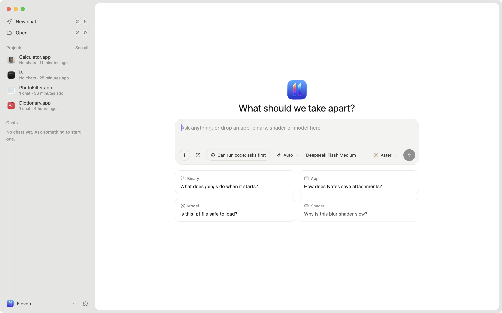

<p align="center">
  <picture>
    <source media="(prefers-color-scheme: dark)" srcset="docs/images/icon-dark.png">
    
  </picture>
</p>

<h1 align="center">Eleven</h1>

<p align="center">一个以 agent 为核心的 macOS 逆向工程应用。</p>

<div align="center">

[English](README.md) · **简体中文** · [繁體中文](README_zh-TW.md) · [日本語](README_ja.md) · [한국어](README_ko.md) · [Türkçe](README_tr.md) · [Русский](README_ru.md) · [Tiếng Việt](README_vi.md) · [ไทย](README_th.md) · [Deutsch](README_de.md) · [Español](README_es.md) · [Français](README_fr.md) · [Українська](README_uk.md) · [Polski](README_pl.md) · [Português (Brasil)](README_pt-BR.md) · [العربية](README_ar.md) · [فارسی](README_fa.md) · [Bahasa Indonesia](README_id.md) · [Italiano](README_it.md)

</div>

<p align="center">
  
</p>

Eleven 是一个围绕 agent 构建的逆向工程应用。放入一个应用、一个二进制文件、一个着色器或一个模型，然后问它是做什么的。任何支持 [Agent Client Protocol](https://agentclientprotocol.com) 的 agent 都能阅读代码、跟踪引用、重命名函数、留下笔记并提出补丁建议，而你在同一个窗口中观看并批准。

分析通过 [REA](https://github.com/morluto/rea) 在 [Ghidra](https://ghidra-sre.org) 上运行。界面用 React 编写，由 [GPUIX](https://www.npmjs.com/package/@gpuix/react) 在 GPUI 上原生渲染。

## 功能

- **自带 agent。** Aster、Claude、Codex、Gemini、Cursor、Copilot、OpenCode 以及任何其他 ACP agent。可以在同一个项目上运行多个，各自拥有独立的对话。
- **Agent 可以操控窗口。** Eleven 提供自己的 MCP 工具，让 agent 能打开函数、切换视图、重命名、添加笔记并提交补丁建议。
- **控制权始终在你手里。** 你或 agent 的每一次更改都会连同作者一起记录在案，并且可以撤销。来自 agent 的字节补丁以建议的形式出现，由你接受或拒绝。
- **Mach-O、ELF 和 PE。** 函数、伪代码、汇编、控制流图、交叉引用、字符串、段和十六进制。
- **项目。** 一个项目就是一个应用或二进制文件。它的对话、重命名、书签、笔记和补丁在重新打开后依然保留。
- **补丁。** 编辑某个地址处的字节并写出打过补丁的副本。原始文件绝不会被改动。
- **差异对比。** 按函数比较两个构建，看看伪代码中发生了什么变化。
- **调试。** 在 LLDB 下运行程序，在你正在查看的函数上设断点，单步执行并读取局部变量。
- **着色器、模型和 GPU 分析。** Metal 着色器和 ML 模型文件在工作台中打开，并与加载它们的代码关联。使用 Instruments 进行分析。
- **Playbook。** 内置技能（例如初次查看、命名函数、追踪功能和网络地图）可与任何 agent 配合使用。
- **导出。** 伪代码、汇编和 Objective-C 类清单。

## 安装

Eleven 在搭载 Apple Silicon 的 macOS 14 或更高版本上运行。

```sh
curl -fsSL https://raw.githubusercontent.com/Zfinix/eleven/main/install.sh | sh
```

这会把 `Eleven.app` 安装到 `/Applications`。构建版本已签名并通过 Apple 公证。

Eleven 还需要：

- **Ghidra 12.x。** 从 [ghidra-sre.org](https://ghidra-sre.org) 下载并解压到 `~/.local/share` 或 `~/Applications`，或者设置 `GHIDRA_INSTALL_DIR`。
- **一个 JDK，21 或更新版本。** `brew install openjdk@21` 即可。Eleven 会自己找到它。
- **一个 agent。** 首次运行时选择一个。需要时 Eleven 会为你安装 ACP 适配器。

## 从源码构建

你需要 [Bun](https://bun.sh)、Node 20 或更新版本、Ghidra 和一个 JDK（同上），以及在本仓库旁边有一份 REA 6.x 的检出（`../rea`），或者让 `ELEVEN_REA` 指向它。

```sh
git clone https://github.com/Zfinix/eleven
git clone https://github.com/Zfinix/rea
cd eleven/app
bun install
bun run dev
```

| 命令 | 作用 |
| --- | --- |
| `bun run dev [file]` | 以热重载方式运行应用，可选地打开一个文件 |
| `bunx tsc --noEmit --noUnusedLocals` | 对应用、测试和脚本做类型检查 |
| `./script/test` | 一次一个文件地运行测试套件 |
| `./script/bundle-macos` | 构建 `build/Eleven.app` |
| `./script/package` | 构建、签名并打包一个发行版 |

## 环境变量

以下全部都是可选的。Eleven 会自己找到常见的安装位置。

| 变量 | 用途 |
| --- | --- |
| `GHIDRA_INSTALL_DIR` | 要使用的 Ghidra 安装位置 |
| `JAVA_HOME` | 用来运行 Ghidra 的 JDK |
| `ELEVEN_REA` | 使用 REA 而不是内置的那一份 |
| `ELEVEN_LLDB_DAP` | 供调试器使用的 `lldb-dap` |
| `ELEVEN_SUPPORT` | Eleven 存放项目和设置的位置 |
| `ELEVEN_SIGN_IDENTITY` | 供 `./script/package` 使用的代码签名身份 |

## 文档

- [MCP 工具](docs/mcp-tools.md)：Eleven 中智能体可用的全部工具，每个工具接收和返回什么，以及权限与隐私。
- [技能](docs/skills.md)：内置剧本，以及如何编写自己的剧本。

## 仓库结构

- `app/` 是应用本身：使用 React 和 TypeScript，基于 GPUIX。
- `launch/` 是发布视频，用 Remotion 制作。
- `install.sh` 是安装脚本。

关于代码如何组织以及它遵循的规则，见 [AGENTS.md](AGENTS.md)。

## 许可

Eleven 以 [Apache License 2.0](LICENSE) 发布。随附的第三方代码列在 [THIRD_PARTY_NOTICES.md](THIRD_PARTY_NOTICES.md) 中。Agent 徽标归其各自所有者所有，仅用于标识相应的 agent。
